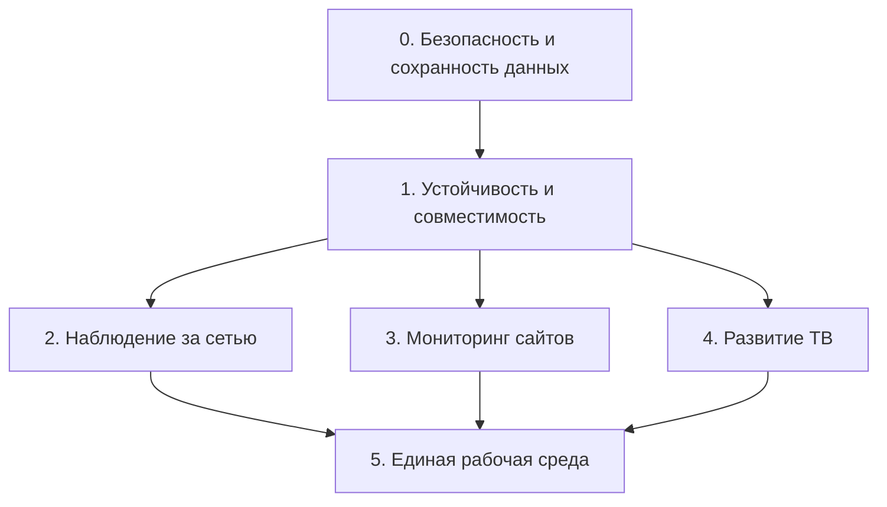

# Карта развития SiteScope Pro

Дополнение от 13 ноября 2026: подробный поэтапный план развития сети и статус новых работ — [NETWORK_EVOLUTION_RU.md](NETWORK_EVOLUTION_RU.md). Этот документ сохраняет исходный общий план beta10.

Версия плана: 11 ноября 2026, 1.0.0-beta10. Порядок задан зависимостями и пользой. Реализован только этап 0; остальные пункты — план. Календарные сроки определяются после оценки команды.

## Этап 0 — реализовано в beta10

| ID | Исправление | Критерий проверки |
| --- | --- | --- |
| FIX-01 | Единый TLS-коннектор: цепочка доверия, имя, SNI, таймаут handshake | Правильное имя принимается, чужое отклоняется до отправки пароля |
| FIX-02 | Backup schema 7 с ТВ-каталогом, источниками и избранным | Экспорт → чистое хранилище → импорт восстанавливает каталог и сводку |
| FIX-03 | Предварительная валидация и откат неудачного восстановления | Повреждённый JSON и ошибка записи не заменяют прежние настройки/SQLite |
| FIX-04 | Удаление секретов из URL и известных полей экспорта | Пароль/токен отсутствуют в копии; живые данные не меняются |
| FIX-05 | Корректная граница API 30 для getOwnerUid | Lint NewApi устранён; API 28/29 использует проверку адреса TUN |
| FIX-06 | Сохранение tvg-name и атомарная запись ТВ-файла | Имя EPG сохраняется после перезапуска |
| FIX-07 | Декодирование SNMP OID с первой дугой 2 | Round-trip включает 2.999.3 и большие значения второй дуги |
| FIX-08 | Потоковый WebDAV, контроль неполных ответов, лимит импорта плейлиста | Передача начинается до полного чтения; буфер до 32 КБ; обрыв вызывает ошибку |
| FIX-09 | Обязательные тесты/Lint в Actions и отчёты | Ошибка блокирует публикацию; XML/HTML сохранены как артефакты |

## Этап 1 — устойчивость перед расширением

| ID / приоритет | Работа | Зависимость | Результат и критерий готовности |
| --- | --- | --- | --- |
| ST-01 / P1 | SavedStateHandle для экрана, запроса, вкладки и канала плеера | Этап 0 | После завершения процесса восстанавливается инструмент и канал; очередь не зависит только от PlayerQueue в памяти |
| ST-02 / P1 | Единые отмена, таймауты и типы ошибок сетевых операций | FIX-01, FIX-08 | «Стоп» закрывает сокеты; уход с экрана не оставляет задач; ошибка записи показана пользователю |
| ST-03 / P1 | Журнал восстановления для прерывания импорта завершением процесса/питания | FIX-02, FIX-03 | Принудительная остановка на каждом шаге оставляет согласованное прежнее либо новое состояние |
| ST-04 / P1 | Матрица API 28, 29, 30, 35, 36; реальные VPN/HEV, Wi-Fi/LTE и multicast | FIX-05 | Проверены запуск/остановка, отзыв разрешения, смена сети, сон и восстановление; результаты приложены к релизу |
| ST-05 / P1 | Интеграционные серверы WebDAV, FTP/FTPS, SSH/SFTP и MQTT | ST-02 | Проверены TLS, обрыв/отмена, chunked upload и серверы с обязательным Content-Length; при необходимости — временный файл для известной длины |
| ST-06 / P2 | Предупреждения Lint, локализация, доступность, устаревшие API | FIX-09 | У каждого подавления узкая область и пояснение; новые реальные замечания не накапливаются |
| ST-07 / P2 | Постепенное выделение core/storage/network/site/tv/vpn; перенос legacy harness | ST-04 | Движки тестируются без UI; JNI-имена сохранены; без общего переписывания приложения |
| ST-08 / P2 | Keep-правила JNI, пробное R8/resource shrinking | ST-04, ST-07 | Xray/HEV работают в оптимизированном APK; опубликован размер до/после |

Физический прогон ST-04 остаётся отдельной проверкой: Robolectric и проверка ELF не заменяют работу VPN и multicast на телефоне. FIX-03 покрывает ошибки выполнения; ST-03 добавляет восстановление после прерывания всего процесса.

## Этап 2 — наблюдение за своей сетью

| ID / приоритет | Расширение | Зависимость | Критерий готовности |
| --- | --- | --- | --- |
| NET-01 / P1 | Постоянная карточка устройства: discovery, сервисы, сканирования, подключения | ST-07 | Смена IP не создаёт дубликат при наличии устойчивого ID; карточки можно объединить/разделить |
| NET-02 / P1 | История доступности и изменения портов, сравнение проверок | NET-01 | Видно время появления/исчезновения сервиса и исходную проверку |
| NET-03 / P1 | Плановые проверки выбранной сети и уведомления | ST-02, NET-02 | Есть выбор сети, целей и интервала; проверка не запускается в другой сети; тревога подтверждается повтором |
| NET-04 / P2 | Карта сети с подсетями и типами устройств | NET-01 | Карта и список открывают одну карточку; есть фильтры изменений/недоступности |
| NET-05 / P2 | IPv6-инвентаризация и объединение dual-stack адресов | NET-01, ST-04 | IPv4 и IPv6 одного устройства связаны; доступны сервисы и экспорт |

## Этап 3 — развитие существующего мониторинга сайтов

| ID / приоритет | Расширение | Зависимость | Критерий готовности |
| --- | --- | --- | --- |
| WEB-01 / P1 | История доступности, HTTP-кодов и задержек с графиками | ST-07 | История имеет срок хранения и экспорт; сбой измерения отличается от сбоя сайта |
| WEB-02 / P1 | Интервалы по цели, повтор перед тревогой, тихие часы | ST-02, WEB-01 | Уведомления отражают подтверждённый сбой и восстановление |
| WEB-03 / P2 | Снимки DNS/сертификатов и уведомления об изменении | WEB-01 | Отчёт показывает старое/новое значение, время и источник |
| WEB-04 / P2 | Сравнение SEO-аудитов и контроль выбранных изменений | WEB-01 | Разница привязана к конкретным аудитам; повтор не создаёт дубликаты проектов |

## Этап 4 — развитие ТВ

| ID / приоритет | Расширение | Зависимость | Критерий готовности |
| --- | --- | --- | --- |
| TV-01 / P1 | Сопоставление каналов при переименовании/смене URL | FIX-06 | Избранное и история сохраняются по tvg-id/сопоставлению; неоднозначные совпадения показаны пользователю |
| TV-02 / P1 | Плановое обновление источников и отчёт об изменениях | TV-01, ST-02 | Добавленные/удалённые каналы видны до очистки; недоступный источник не стирает каталог |
| TV-03 / P2 | Управление EPG-источниками и ручное сопоставление | FIX-06, TV-01 | Выбор сохраняется при обновлении плейлиста и восстановлении копии |
| TV-04 / P2 | Секреты авторизованных источников в Keystore | FIX-04, TV-01 | Учётные данные отделены от каталога, журналов и экспорта; есть повторный вход |
| TV-05 / P2 | История качества потока и диагностика буферизации | WEB-01, ST-04 | Показаны измеренные параметры и фактическая причина ошибки |

## Этап 5 — единая рабочая среда

| ID / приоритет | Работа | Зависимость | Критерий готовности |
| --- | --- | --- | --- |
| APP-01 / P2 | Центр задач и уведомлений | NET-03, WEB-02, TV-02 | Видны расписание, работа, результат и отмена |
| APP-02 / P2 | Диагностический пакет для поддержки | FIX-04, ST-02 | Версия, шаги сбоя и очищенные журналы; трафик/TLS-ключи — только отдельным выбором |
| APP-03 / P2 | CSV/JSON экспорт проектов, сети и отчётов | NET-02, WEB-01, TV-02 | Форматы версионированы; секреты исключаются тем же контрактом, что из backup |
| APP-04 / P2 | Основная ветка и история релизов | FIX-09 | main содержит актуальное приложение, стабильные версии имеют отдельные теги; beta — предварительный канал |

Рекомендуемый следующий пакет: ST-01 → ST-02 → ST-03 → ST-04. Затем NET-01/NET-02, WEB-01 и TV-01 можно выполнять независимо.
